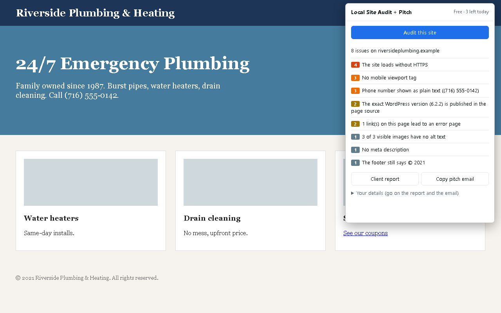
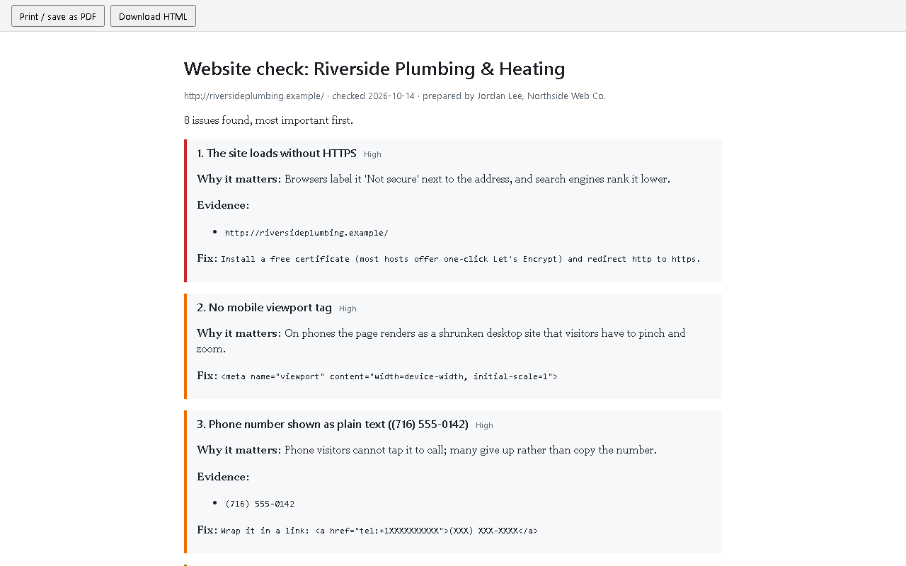
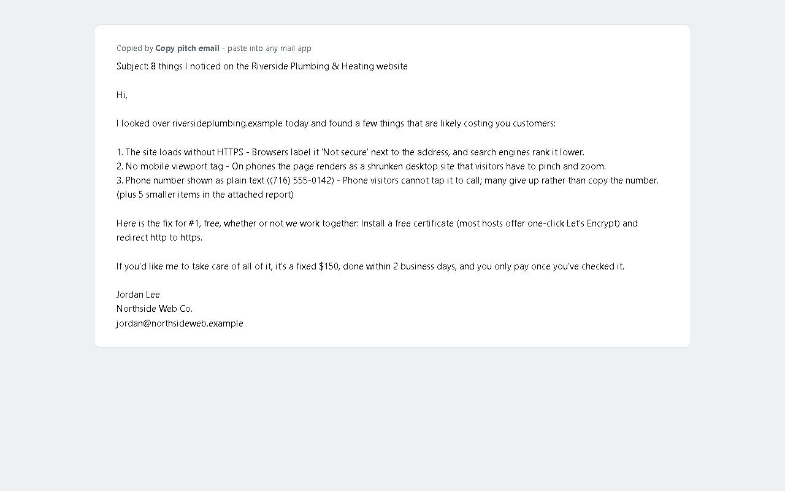

# Local Site Audit + Pitch

A browser extension for web designers, freelancers and small agencies who win
clients by showing them what is wrong with their current website.

Open a local business's site, click the icon, and in a few seconds you get:

- **Real defects, with evidence** - not a generic score.
- **Why each one costs the owner customers**, in words the owner understands.
- **A client report** to print, save as PDF or send, with your name and contact on it.
- **A pitch email written from the findings** - the top three issues, one fix given
  away free, and your price. Paste it into your mail app and attach the report.

## What it checks

Phone numbers visitors can't tap to call, pages that load without HTTPS, files
browsers block on a secure page, no mobile viewport, images with no alt text,
oversized images, an exposed WordPress version, a footer still showing an old
copyright year, broken links, a missing title or meta description.

These are the faults found most often when scanning 43,000 US small-business
websites: 13,662 had images with no alt text, 7,646 showed a phone number
visitors could not tap, 4,338 still showed an old copyright year, and 2,202 did
not load at all.

## Private by design

The extension reads only the page you click it on, and only when you click.
Permissions are `activeTab`, `scripting` and `storage` - no host permissions, no
remote code, no analytics. Your audits, your details and any license key stay in
your browser.

## Install

**Microsoft Edge:** [install from Edge Add-ons](https://microsoftedge.microsoft.com/addons/detail/hcdpnkilmailiiljmaeldcomceoibajh) (one click, updates itself).
Firefox Add-ons: in review.

Chrome, Brave or any other Chromium browser:

1. Download `local-site-audit-0.1.2-edge.zip` from the
   [latest release](https://github.com/Stephen-Psaradellis/local-site-audit/releases/latest)
   and unzip it (or clone this repo).
2. Open `chrome://extensions` (or `edge://extensions`) and turn on **Developer mode**.
3. Click **Load unpacked** and pick the unzipped folder.

Every audit is saved in the popup's *Audit history* (one row per site: business, date, issue count, top issue), so your audits become a prospect list. The free edition runs 3 audits a day, shows the last 3 in the history and puts a small footer on reports.

**Pro ($59 once):** unlimited audits, the full history with *Export CSV*, no footer. Use *Get a Pro key* in the popup (or email
s.n.psaradellis@gmail.com with the subject "Local Site Audit Pro key"): you get a card invoice,
and the key by email once it is paid.

## Related

- Don't want to audit sites one by one? Lists of local businesses whose site is
  down or broken, with the evidence already found, by city and business type:
  [prospect packs](https://stephen-psaradellis.github.io/demos/prospect-packs.html)
  (10 rows free for any city).
- The same email-forgery check (SPF/DKIM/DMARC) runs in a browser:
  [email-forgery-check](https://stephen-psaradellis.github.io/demos/email-forgery-check.html).
- On WordPress? [Mailwick Site Audit](https://github.com/Stephen-Psaradellis/mailwick-site-audit)
  runs similar checks from inside the site.

Written with an AI system (Claude) under my direction; I review and maintain it.
Issues and pull requests welcome.

## License

MIT. See `LICENSE`.
